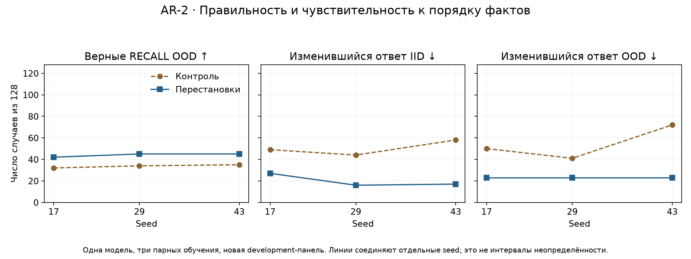

# AR-2 · Перестановка фактов при обучении: устойчивость ответа малой модели

**Статус:** завершено ограниченное исследование сохранённых опытов. Измерения — октябрь 2026; повторный разбор — 6 ноября 2026. Astrelik Research Lab.

## Результат

Случайные перестановки независимых FACTS при обучении уменьшили чувствительность ответов Transformer к обратному порядку фактов. На новой панели из 128 пар RECALL на каждый split среднее число изменившихся ответов снизилось с **50,33 до 20 для IID** и с **54,33 до 23 для OOD**. Среднее число правильных исходных RECALL-ответов OOD выросло с **33,67 до 44 из 128**; приросты трёх seed — **+10, +11, +10**.

Но на первоначальной общей панели из 96 задач среднего выигрыша не было. На новой общей IID-панели у seed17 число PASS снизилось 155→151. Вывод — локальное улучшение устойчивости в формальной задаче, а не универсальное отсутствие регрессий или появление разговорной модели.

## Вопрос и ближайшие работы

Независимые записи `a=3;b=5` и `b=5;a=3` задают один и тот же ответ на `ASK a`. Проверяем, помогает ли изменение их порядка на обучении сохранять правильность при перестановке на новых примерах.

Инвариантность к перестановкам изучалась в [Deep Sets](https://arxiv.org/abs/1703.06114), а зависимость ответа от положения информации — в [Lost in the Middle](https://arxiv.org/abs/2307.03172). Это контекст, не воспроизведение этих работ: здесь архитектура не изменяется, а эксперимент касается малого Transformer и коротких процедурных запросов. Новизна общего метода аугментации не заявляется.

## Условия сравнения

Шесть checkpoints: три сохранённых контроля и три обучения с перестановками, seed 17/29/43. Модель — Transformer 1 314 240 параметров, четыре слоя, d_model=160, четыре attention-head, контекст до 256 токенов; lossless lexical-v1 кодирование входа, ASCII-ответы. Это не предобученная большая языковая модель.

В каждой паре совпали конфиги модели, обучения и данных, исходные численные метрики, хеш последовательности minibatch-индексов, оценочные панели и счётчики входных/целевых токенов. На каждое обучение — 2048 обновлений, batch16, LR0,0003, weight decay0,01, clip1, CPU четыре потока. Только в RECALL переставлялись независимые FACTS; порядок операций UPDATE и COUNTER менять нельзя, поэтому он сохранялся. Код кандидата дополнительно содержит ограничения против известных оценочных запросов; равенство перечня всех полей `data_hashes` не требуется: эти защитные источники есть только у кандидата. Сами train/IID/OOD-файлы и их хеши совпадают внутри пары.

Входных токенов по seed: 1 044 420 / 1 044 374 / 1 045 697; целевых: 70 399 / 70 428 / 70 355 — одинаково в обеих ветках каждого seed. Время завершённых обучений: контроль 91,09–99,24 с, кандидат 98,99–104,25 с; это не отдельный тест производительности.

Начато четыре попытки обучения кандидата, завершено три. Первая seed43 остановилась с Windows WinError5 на записи статуса после сохранённого префикса 1968 шагов. Полный повтор с начала использовал bounded retry IO; сохранённая проверка подтвердила точное совпадение префикса. Неудачная попытка сохранена; её время не включено в указанный диапазон завершённых обучений. Нового обучения при подготовке этого отчёта не было.

## Данные и критерии

Три семейства: RECALL (найти значение ключа), UPDATE (учесть последовательные записи), COUNTER (выполнить ADD/SUB). На новой панели 384 IID и 384 OOD запросов, по 128 каждого семейства. OOD здесь — процедурная development-грамматика с иными условиями/длинами, не общий реальный мир. Дополнительно для 128 RECALL каждого split создан обратный порядок фактов: 1024 входа × шесть моделей = **6144 сохранённых ответа**.

Пример:

```text
TASK RECALL
FACTS a=3;b=5
ASK a
ANSWER:
```

После замены FACTS на `b=5;a=3` эталон остаётся `3`. Эта пара иллюстративная, не дополнительное измерение. В RECALL ключи уникальны. Для UPDATE сохранение последней записи вычисляется последовательно; для COUNTER — независимым суммированием операций.

PASS требует точного текстового совпадения, естественного EOS и отсутствия ошибки декодирования. Пробелы не обрезаются. Смена ответа при перестановке означает несовпадение двух текстов и сама по себе не доказывает, что какой-либо из них верен. Поэтому отдельно считаем пары, где верны оба ответа. Генерации ограничены восемью новыми токенами.

Новая панель семантически отделялась от прежних train/development: для независимых FACTS/INIT сортируются записи, последовательные WRITE/операции сохраняют порядок. Повторный разбор не обнаружил совпадений таких сигнатур с данными моделей; это проверка данной формальной грамматики, не доказательство отсутствия всех видов утечки. Закрытый final не создавался и не читался.

## Новая панель: все seed

Каждое число до стрелки — контроль, после — обучение с перестановками.

| Seed | Панель | Общие PASS /384 | RECALL PASS /128 | Ответ изменился /128 | Оба ответа верны /128 |
|---|---|---:|---:|---:|---:|
| 17 | IID | 155 → 151 | 59 → 57 | 49 → 27 | 36 → 47 |
| 17 | OOD | 93 → 99 | 32 → 42 | 50 → 23 | 23 → 39 |
| 29 | IID | 139 → 152 | 48 → 54 | 44 → 16 | 37 → 46 |
| 29 | OOD | 88 → 108 | 34 → 45 | 41 → 23 | 27 → 37 |
| 43 | IID | 139 → 150 | 48 → 60 | 58 → 17 | 29 → 50 |
| 43 | OOD | 93 → 100 | 35 → 45 | 72 → 23 | 17 → 38 |

Средние общие PASS: IID 144,33→151; OOD 91,33→102,33 из384. Обратный RECALL: IID52,33→55, OOD38,33→43,33 из128. Для seed17 исходный IID RECALL ухудшился59→57, несмотря на улучшение парной устойчивости. Ни отдельные потери, ни худшие seed не скрыты.



Первоначальная известная панель из96 задач давала IID36,33→36 и OOD19→18,33. Поэтому нельзя заменить историю утверждением «все оценки улучшились»: вывод о локальной памяти был выделен и затем проверен на новой панели. Новая панель — development-подтверждение, а не независимый финальный benchmark. Старые baseline повторно не обучались.

Заранее зафиксированные пять локальных критериев требовали: OOD RECALL среднего выигрыша ≥3; отсутствия снижения среднего IID RECALL и среднего reversed OOD RECALL; снижения чувствительности хотя бы на25% в обоих split; положительного OOD RECALL-эффекта минимум у двух seed. Сохранённая проверка сообщает прохождение всех пяти; текущий пересчёт подтверждает исходные счётчики. Это локальные критерии, а не статистическая значимость.

## Что проверено и что неизвестно

Повторно сверены **218 хешей** исходников, данных, ответов, протоколов и checkpoints. Независимый от исходного grader код заново вычислил эталоны из текста, восстановил ASCII-ответы из token IDs, проверил EOS и переоценил все6144ответа. Пересчитанные счётчики совпали с сохранённым root-review. Шесть checkpoints проверены по хешам без загрузки модели. Автоматическая проверка не является внешним человеческим рецензированием.

Не выполнялись новые forward, повторное обучение или проверка на иных моделях/естественных текстах. Совпадение исходных метрик — не новый побитный аудит начальных весов. Три seed недостаточны для универсальной оценки эффекта; домены и парные запросы не считаются независимыми обучающими повторениями. Доверительные интервалы и p-value не заявляются. Причинный механизм изменения представлений внутри модели не установлен.

## Вывод

Перестановка независимых фактов при обучении в этом стенде дала более устойчивые и чаще правильные RECALL-ответы на новых OOD-примерах. Улучшение устойчивости не гарантирует общего выигрыша: первоначальная панель не улучшилась, отдельные IID-результаты ухудшились. Следующее обоснованное расширение — заранее заданная новая грамматика/длина или проверка иных сохраняющих смысл перестановок, а не автоматическое продолжение старых checkpoints.

## Воспроизведение анализа

Из папки исследования, Python 3.10+ без ML-библиотек:

```sh
python code/analyze.py
python -m unittest discover -s code -v
```

Команды проверяют сохранённые ответы и пересчитывают [общие оценки](metrics/scores.csv), [парные показатели](metrics/order_sensitivity.csv) и [бюджеты](metrics/training.csv). [Измерения и синтетические запросы](evidence/measurements.json), [происхождение и хеши](evidence/provenance.json) входят в комплект. Это воспроизведение оценки сохранённых ответов, не полное воспроизведение обучения/генерации. Для нового обучения нужны исторический runtime, данные и ML-среда; веса в этот пакет не включены.

## Участие ИИ и лицензия

ИИ помогал с экспериментальными инструментами, проверками, анализом и оформлением. Метрики происходят из фактических сохранённых запусков. Текст, графики и собственные синтетические материалы — CC BY4.0, код — MIT; общие условия опубликованы в корне лаборатории. Авторство: Astrelik Research Lab,2026.

Перестроение графика: `python -m pip install -r code/requirements-figures.txt`, затем `python code/render.py` (Python 3.12).

[Лицензия текста и графиков CC BY 4.0](../../../LICENSE) · [Лицензия кода MIT](../../../LICENSE-CODE).
