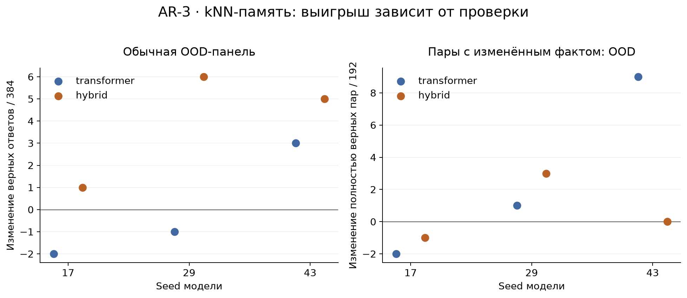

# AR-3 — kNN-память: выигрыш в точности и реакция на изменение факта

Astrelik Research Lab · 6 ноября 2026 · завершённое ограниченное исследование

## Краткий результат

Помогает ли внешняя память, подключённая к замороженной модели, и означает ли рост обычной точности, что модель надёжнее отвечает при изменении условий? На наших синтетических задачах это разные проверки. У гибридной модели kNN повышает средний результат обычной OOD-панели на 4 ответа из 384; на парах с изменённым условием выигрыш составляет лишь 0,67 полностью верной пары из 192 и не повторяется во всех seeds. У Transformer средний обычный OOD-результат не меняется, а парный выигрыш заметно зависит от seed.

Это исследование границ конкретного подключения памяти, а не новый метод и не доказательство бесполезности kNN. Все сравнения выполнены на development-панелях; независимая итоговая проверка на final-наборе не проводилась.

## Вопрос и связь с другими работами

В [kNN-LM, Khandelwal et al.](https://arxiv.org/abs/1911.00172) распределение языковой модели смешивается с распределением ближайших соседей в пространстве представлений; память может строиться по исходным учебным данным без дополнительного обучения. Здесь проверяем этот принцип на маленьких моделях и трёх процедурных задачах. Мы не воспроизводим масштаб, корпус или результат исходной статьи.

Сначала сравниваем обычную точность. Затем меняем один значимый элемент входа и требуем правильного ответа на обе версии. Вторая проверка помогает отличить узнавание похожего примера от устойчивого использования изменившегося условия; сама по себе она не устанавливает внутренний механизм ошибки.

## Условия

Две группы замороженных checkpoints: Transformer и `hybrid_attention_reference`, каждая с seeds 17, 29, 43. Ширина представления — 160, словарь — 260, контекст — до 256 токенов; используется `lexical-v1`, сжатие фиксированных ключевых слов только во входе. Transformer имеет 4 слоя и 4 головы. Гибридная конфигурация включает attention и state-space-компонент; это конкретная реализация стенда, без вывода о всех гибридных моделях. Checkpoints уже обучены на 2048 синтетических задачах каждый; обучения в рамках подключения памяти нет. Сравнение архитектур не является оценкой их превосходства при равном вычислительном бюджете.

Для каждой модели сравниваем три режима на одних входах:

- `base` — исходное распределение модели;
- `memory` — 0,75 распределения модели + 0,25 распределения kNN;
- `shuffled` — та же память и ключи, но значения перемешаны фиксированным seed 20261028.

Память хранит представления перед выходной головой и следующие целевые токены только из supervised-позиций train. На каждом шаге выбираются 8 ближайших ключей по квадрату евклидова расстояния; веса пропорциональны `exp(-distance / 1.0)`. Декодирование жадное, максимум 8 новых токенов. Параметры памяти одинаковы для всех моделей и обеих панелей, подбора по этим результатам не проводилось. Ничья расстояний разрешается по исходному индексу строки. Контроль с перемешиванием проверяет значение связи ключ—токен, но не заменяет сравнение с другими методами памяти.

Пример индекса Transformer seed 17: 4401 строка, 160 признаков, 8 520 336 байт массива данных вместе с FP64-кешем расстояний; это не полная RAM процесса и не оценка задержки. Первоначальные workers работали на CPU, записали неизменность модели и ноль шагов оптимизатора. При оформлении заново проверены файлы, а forward и измерение производительности не повторялись.

## Данные и оценка

Три семейства: RECALL — найти значение ключа; UPDATE — применить записи и взять последнее значение; COUNTER — выполнить ADD/SUB от начального значения. IID обозначает распределение привычных структур, OOD — более длинные структуры этого же генератора. Это синтетический перенос по длине, а не естественный язык или перенос между реальными доменами.

Обычная панель: 384 IID и 384 OOD задачи, по 128 каждого семейства в каждом split. Парная панель: по 192 пары IID и OOD, по 64 пары каждого семейства. В паре меняется запрошенное значение FACTS, последняя запись запрошенного ключа либо начальное значение счётчика. Правильный ответ обязательно меняется. Таким образом, каждая панель содержит 768 входов; по 6 моделей × 3 режима получается 13 824 ответа на панель, всего 27 648.

Ответ считается верным при точном совпадении строки, корректном ASCII-декодировании и естественном EOS. Эталон заново вычисляется из текста задачи; сохранённого флага `passed` для проверки недостаточно. В парной метрике оба ответа должны быть верны. Отдельно считаем повтор старого правильного ответа на изменённом входе при верном исходном ответе; знаменатель этой условной метрики зависит от режима.

Свежая проверка нормализует порядок FACTS/INIT, сохраняя порядок WRITE/операций, и не находит совпадений оцениваемых входов с train каждого checkpoint. Это проверка совпадений условий, а не доказательство независимости всех шаблонов. По два development-набора используются последовательно; по ним нельзя заявлять качество на нетронутом final-наборе.

## Обычная точность

Среднее число верных ответов по трём seeds, знаменатель **384** в каждой строке. Дробная часть появляется только при усреднении.

| Модель | Split | base | memory | shuffled |
|---|---|---:|---:|---:|
| Transformer | IID | 151,33 | 152,00 | 150,00 |
| Transformer | OOD | 97,67 | 97,67 | 95,33 |
| Hybrid | IID | 153,00 | 156,67 | 152,00 |
| Hybrid | OOD | 94,33 | 98,33 | 94,33 |

У Hybrid OOD-прирост по seeds — **+1, +6, +5** ответов, средний прирост +1,04 процентного пункта. Для Transformer — **−2, −1, +3**, средний ноль. Даже у Hybrid есть IID-регрессия seed 29: 157 → 156. Улучшение среднего не означает отсутствия регрессий.

Исходный протокол обычной панели считал ограниченный эффект поддержанным при неухудшении среднего IID, среднем OOD-приросте не менее 3/384, положительном OOD-приросте минимум у двух seeds и среднем OOD выше shuffled. Hybrid удовлетворяет этому описательному правилу, Transformer — нет. Это правило не является тестом статистической значимости.

## Реакция на изменение условия

Среднее число пар, где **оба ответа верны**; знаменатель **192 пары**, не 384 отдельных ответа.

| Модель | Split | base | memory | shuffled |
|---|---|---:|---:|---:|
| Transformer | IID | 46,00 | 45,33 | 44,67 |
| Transformer | OOD | 13,00 | 15,67 | 12,67 |
| Hybrid | IID | 46,33 | 46,33 | 45,00 |
| Hybrid | OOD | 9,67 | 10,33 | 9,67 |

OOD-прирост полностью верных пар: Transformer **−2, +1, +9**, Hybrid **−1, +3, 0**. У Transformer среднее поднимается, но основной вклад даёт один seed; у Hybrid обычный выигрыш не сопровождается устойчивым парным выигрышем. Абсолютная парная точность остаётся низкой. Разные панели не позволяют буквально приписать потерю каждого обычного выигрыша конкретной интервенции.

Повтор старого ответа на изменённом OOD-входе **при верном исходном ответе**, суммарно по трём seeds:

| Модель | base | memory | shuffled |
|---|---:|---:|---:|
| Transformer | 44 / 145 | 48 / 145 | 42 / 139 |
| Hybrid | 81 / 168 | 79 / 173 | 77 / 164 |

kNN не устраняет такие ошибки. Эти отношения нельзя читать как безусловную частоту ошибок: учитываются только пары с правильным исходным ответом, и состав подмножества меняется между режимами. Повтор старой строки не доказывает, что причиной была именно извлечённая запись.



График показывает `memory − base`; панели имеют разные единицы и масштабы. [SVG](figures/results.svg), все значения по seeds и семействам — в [scores.csv](metrics/scores.csv), парные показатели и их знаменатели — в [pairs.csv](metrics/pairs.csv).

## Что можно заключить

Фиксированная train-only kNN-память дала небольшой воспроизводимый по направлению OOD-выигрыш у этой гибридной модели на обычной панели. Поддержки общей надёжности при изменении факта недостаточно: парный выигрыш слабый или зависит от seed, старые ответы продолжают повторяться. Поэтому для оценки памяти полезно сохранять обе проверки и показывать все seeds, а не только среднюю обычную точность.

Ограничения: три seeds; две конкретные архитектуры и один набор параметров памяти; зависимые задачи одного генератора; development-оценка; отсутствие повторного обучения и нового forward при публикации. Доверительные интервалы и p-values не заявляются. Мы не измеряли пользу на больших языковых моделях, долговременную память диалогов, оптимальные настройки kNN или причинный механизм повторения старого ответа.

## Воспроизведение

Из папки исследования, Python 3.11+ без сторонних зависимостей:

```sh
python -B code/analyze.py
python -B -m unittest discover -s code -p test_analysis.py
```

Скрипт переоценивает все ответы, проверяет токены/EOS/эталоны и совпадение с исходными аудитами, пересоздаёт CSV. [measurements.json](evidence/measurements.json) содержит синтетические задачи и сохранённые ответы всех режимов; [provenance.json](evidence/provenance.json) — 264 проверенных SHA-256 источников и контрольные итоги прежних аудитов. Хеши технических файлов документируют происхождение; сами эти файлы не нужны для публичного пересчёта.

Для графиков отдельно: `python -m pip install -r code/requirements-figures.txt`, затем `python -B code/render.py`. Код [knn_reference.py](code/knn_reference.py) показывает использованную математику памяти; для самостоятельного использования требует NumPy. Он не вызывается пересчётом сохранённых ответов. Checkpoints, индексы и полный стенд обучения/инференса в пакет не включены: команды выше воспроизводят **анализ сохранённых измерений**, не полное получение ответов моделью.

Код и оформление подготовлены с помощью ИИ; измерения происходят из сохранённых запусков и проверены отдельным пересчётом. Проверки пакета не являются независимым научным рецензированием.

Текст, графики и измерительные материалы — [CC BY 4.0](../../../LICENSE); программный код — [MIT](../../../LICENSE-CODE). Рекомендуемая ссылка: **Astrelik Research Lab (2026). AR-3 — kNN-память: выигрыш в точности и реакция на изменение факта.**
