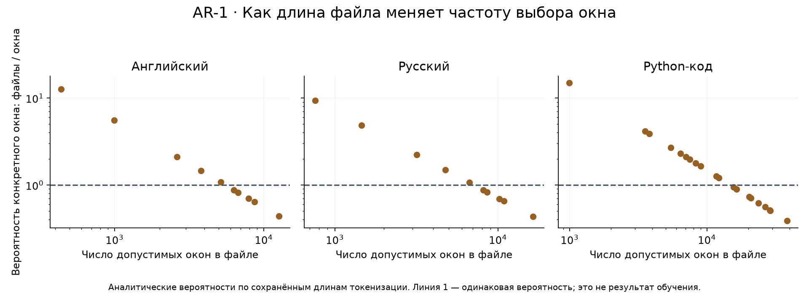
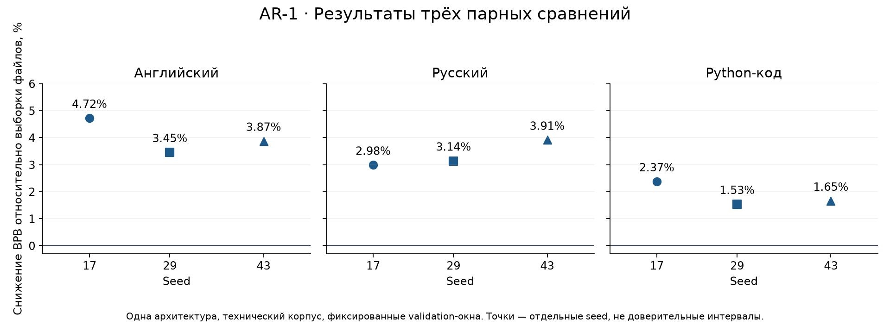

# AR-1 · Выборка учебных данных: равномерно по файлам или по окнам

**Статус:** завершённое ограниченное сравнение существующих опытов. Измерения — октябрь 2026; разбор и оформление — 5 ноября 2026. Это первый исследовательский отчёт Astrelik Research Lab. Новая архитектура или универсальный рецепт обучения не заявляются.

## Краткий результат

На небольшой гибридной языковой модели выборка допустимых учебных окон дала меньшую ошибку BPB, чем равномерная выборка файлов, во всех трёх доменах и на всех трёх seed. Снижение отношения средних BPB составило **4,02% для английского, 3,34% для русского и 1,85% для Python-кода**. Это ошибка предсказания текста на фиксированной development-панели, а не точность ответов или улучшение программирования.

Сравнение включает шесть обучений: по одной паре «файлы / окна» для seed 17, 29 и 43. Данные seed 17 получены в первоначальном экране и переиспользованы; две следующие пары выполнены отдельно. Оформление этого отчёта не включало нового обучения.

## Вопрос и устройство сравнения

Если короткий и длинный документы выбирать одинаково часто, отдельное окно короткого документа будет попадать в обучение чаще. Проверяем, меняет ли устранение этой неоднородности development-BPB при одинаковом числе обновлений и целевых токенов.

Пусть в домене N документов, длина документа i равна Lᵢ токенов, а контекст C = 256. Для входного окна и следующего целевого токена доступны Wᵢ = Lᵢ − C стартов, от 0 до Wᵢ − 1. Все документы корпуса длиннее контекста. Окна не переходят границы документов; EOS и padding не добавляются.

- **Выборка файлов:** сначала документ с вероятностью 1/N, затем старт внутри документа с вероятностью 1/Wᵢ. Вероятность конкретного окна — 1/(N·Wᵢ).
- **Выборка окон:** старт равномерно выбирается из всех допустимых стартов домена. Вероятность конкретного окна — 1/ΣWⱼ; вероятность выбора документа — Wᵢ/ΣWⱼ.

Домены выбираются одинаковым round-robin расписанием: английский, русский, код. Меняется распределение внутри домена. Равномерность окон не означает равномерность отдельных целевых токенов: внутренние токены документа входят в большее число пересекающихся окон, чем граничные.



Для самого короткого файла вероятность конкретного окна при выборке файлов была выше, чем при выборке окон, в **12,60 раза для английского, 9,39 раза для русского и 14,91 раза для кода**. Это расчёт распределения выборки, а не доказанная единственная причина различия BPB. Выборка файлов сама по себе не является ошибкой: она задаёт другой вес документам.

## Модель, корпус и бюджет

Модель — одна гибридная реализация, **2 237 192 параметра**; d_model=192, словарь BPE=2048, контекст=256. Внутри пары совпадают модель, seed, исходные численные метрики, корпус, токенизатор, настройки обучения и оценочные окна. Сохранённые протоколы и код проверены; отдельный хеш начального state_dict в этой проверке не восстанавливался.

На каждый run: 1024 обновления AdamW, LR=0,0003, betas=(0,9; 0,95), weight decay=0,01, clip norm=1, эффективный batch=8, microbatch=2. Цель — next-token cross-entropy по всем позициям. Всего **2 097 152 целевых токена**, из них 700 416 английских и по 698 368 русских и кодовых. Вычисления выполнялись на CPU, четыре потока.

Корпус: Python-документация на английском и русском и модули стандартной библиотеки Python. В train — 10 английских, 10 русских и 20 кодовых файлов, суммарно 1 341 930 байтов. В validation — 2 английских, 2 русских и 4 кодовых файла, суммарно 268 359 байтов. Переводы связанных глав отнесены к одному split; для кода отложены целые модули. Токенизатор обучался только на train. Совпадающих целиком файлов между split по хешам не обнаружено; это не исключает общие фрагменты, примеры или семантическую близость.

Исходные атрибуции указывают PSF2 для документации/кода и дополнительное 0BSD для примеров. В этот пакет включены численные результаты, длины, хеши и код анализа; оригинальные тексты корпуса и веса не распространяются. Точное повторение обучения требует восстановления этих источников и исходной среды.

## Оценка и результаты

BPB = сумма отрицательных логарифмов вероятностей целевых токенов / (ln(2) × число соответствующих UTF-8 байтов). Меньше — лучше. Внутри домена суммируются NLL и байты, а не усредняются BPB отдельных окон. Внешний итог в процентах — `100 × (1 − mean(BPB_окна) / mean(BPB_файлы))` по трём seed, не средний процент из таблицы.

Оценка использует **64 фиксированных окна на домен**: 8 батчей по 8 окон. Документы validation выбираются равномерно по файлам; это распределение не изменялось между ветками. Таким образом, сравниваем обучение на разных распределениях при одной и той же file-weighted оценке, а не получаем точную BPB всего корпуса.

| Seed | Домен | BPB: файлы | BPB: окна | Снижение |
|---|---|---:|---:|---:|
| 17 | Английский | 2.28687 | 2.17889 | 4.72% |
| 17 | Русский | 1.54993 | 1.50368 | 2.98% |
| 17 | Python-код | 2.31368 | 2.25882 | 2.37% |
| 29 | Английский | 2.26492 | 2.18669 | 3.45% |
| 29 | Русский | 1.55797 | 1.50909 | 3.14% |
| 29 | Python-код | 2.30727 | 2.27192 | 1.53% |
| 43 | Английский | 2.27409 | 2.18608 | 3.87% |
| 43 | Русский | 1.55399 | 1.49324 | 3.91% |
| 43 | Python-код | 2.32247 | 2.28414 | 1.65% |



Разброс снижений по seed: английский **3,45–4,72%**, русский **2,98–3,91%**, код **1,53–2,37%**. Девять строк таблицы не являются девятью независимыми повторениями: три домена измерены на каждой из трёх моделей. Доверительные интервалы и статистическая значимость не заявляются. Совпадение направления на трёх seed поддерживает локальный результат, но не определяет эффект на других корпусах или архитектурах.

Окна пересекаются, поэтому число посчитанных целевых позиций превышает число уникальных позиций:

| Домен | Файлов validation | Посчитано позиций | Уникальных целевых позиций | Доступно целевых позиций в файлах |
|---|---:|---:|---:|---:|
| Английский | 2 | 16384 | 11197 | 19489 |
| Русский | 2 | 16384 | 12489 | 26381 |
| Python-код | 4 | 16384 | 11659 | 45925 |

«Доступно» здесь означает сумму Lᵢ−1; не все эти позиции могут одинаково участвовать в фиксированных полноразмерных окнах. Уникальные позиции восстановлены по сохранённым offset без запуска модели. Не следует трактовать пересекающиеся окна как независимые наблюдения.

## Токены, байты и время

| Seed | Выборка | Целевых токенов | Обработано байтов | Время сеанса, с |
|---|---|---:|---:|---:|
| 17 | Файлы | 2,097,152 | 6,306,970 | 437.89 |
| 17 | Окна | 2,097,152 | 6,392,367 | 337.79 |
| 29 | Файлы | 2,097,152 | 6,293,135 | 398.59 |
| 29 | Окна | 2,097,152 | 6,412,629 | 402.77 |
| 43 | Файлы | 2,097,152 | 6,284,987 | 348.28 |
| 43 | Окна | 2,097,152 | 6,403,476 | 338.54 |

Токенные бюджеты равны, байтовые — различаются. Это сравнение при фиксированном числе токенов, а не байтов. Сохранённое время включает подготовку, обучение, оценку и генерацию примеров, поэтому по нему нельзя заключать об ускорении самого шага или вычислительных ядер. Пары не являются отдельным контролируемым тестом производительности.

## Проверки и ограничения

При подготовке отчёта сверены **133 хеша** источников/артефактов и **шесть checkpoints**, совпадение оценочных receipts и начальных численных метрик внутри пар. BPB пересчитана из сохранённых NLL, числа токенов и байтов и сопоставлена с отдельными сохранёнными quality-review. Квалификация sampler проверяет биекцию допустимых стартов и отклонение некорректных входов.

Этот разбор не повторял обучение или forward модели. Отдельный процесс автоматической проверки не является независимым человеческим рецензированием. Полного перечня версий исторической обучающей среды в отчёте нет; поэтому побитное повторение обучения на другой машине не обещается.

В некоторых исторических полях протоколов у оконной ветки осталось общее описание «per-file windows», а в `scope` результатов — текст более ранней архитектурной серии. Реальную ветку определяют `train_sampling`/`recipe` и сохранённый worker. Исходные файлы не исправлялись; вывод этого отчёта относится к сопоставленным настройкам, а не к унаследованным формулировкам.

Результат ограничен одной архитектурой, узким техническим корпусом, тремя seed и повторно использованной development-панелью. Новые корпуса, final-панель, другие длины контекста и поведенческие задачи не проверялись. Не установлено, какой отдельный тип документов дал выигрыш; измеренное изменение распределения — правдоподобное объяснение, требующее отдельного контролируемого сравнения для причинной детализации.

## Вывод и дальнейшая работа

В данном сравнении равномерная выборка допустимых окон обеспечила меньшую development-BPB во всех трёх доменах на каждом seed при одинаковом токенном бюджете. Это завершённый локальный результат. Для расширения вывода полезнее следующая заранее определённая проверка на другом составе/распределении длин корпуса или другом способе оценки, чем продление тех же run. Новые опыты в рамках оформления не назначались.

## Воспроизведение отчёта

Из папки этого исследования, Python 3.10+:

```sh
python code/reproduce.py
python -m unittest discover -s code -v
```

Эти команды пересчитывают CSV/JSON из [пакета измерений](evidence/measurements.json), проверяют арифметику и sampler без torch, токенизатора, исходного корпуса и модели. Для перестроения графиков используется Python 3.12 и Matplotlib:

```sh
python -m pip install -r code/requirements-figures.txt
python code/reproduce.py --figures
```

[Результаты CSV](metrics/results.csv) · [Бюджеты](metrics/budgets.csv) · [Вероятности выборки файлов](metrics/file_exposure.csv) · [Покрытие оценки](metrics/evaluation_coverage.csv) · [Происхождение и хеши](evidence/provenance.json).

Это воспроизведение анализа сохранённых измерений; полный повтор обучения требует исходной технической среды, корпуса и ML-кода. Не следует выдавать успешный пересчёт таблиц за новое подтверждение модели.

## Участие ИИ

ИИ помогал готовить код опытов, автоматические проверки, анализ и текст. Числа происходят из выполненных запусков; графики результатов не являются симуляцией обучения. Аналитическая схема вероятностей отдельно обозначена. Независимое человеческое рецензирование не заявляется.

## Лицензии и ссылка на работу

Текст и графики — [CC BY 4.0](../../../LICENSE); код в `code/` — [MIT](../../../LICENSE-CODE). Условия для сторонних материалов сохраняются. Рекомендуемая ссылка: **Astrelik Research Lab (2026). AR-1 — Выборка учебных данных: равномерно по файлам или по окнам.** При распространении укажите ссылку на работу, лицензию и внесённые изменения.
