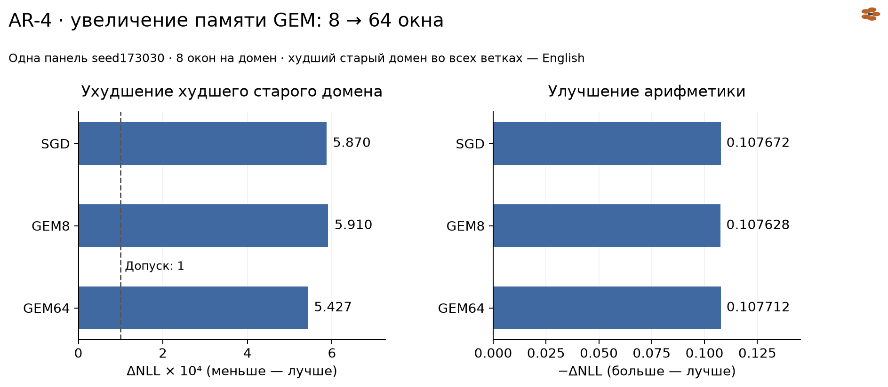
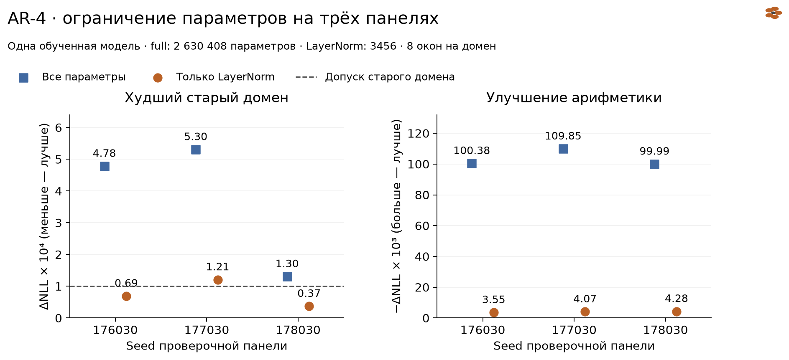

# AR-4 — локальная защита от регрессий: перенос на другие примеры

Astrelik Research Lab · 6 ноября 2026 · завершённое ограниченное исследование

## Краткий результат

На маленькой гибридной модели проверяем, переносится ли локальная защита старых задач на другие примеры. **Корректной проекции градиента GEM оказалось недостаточно для выполнения нашего критерия сохранения ошибки на проверочных панелях.** Увеличение памяти с 8 до 64 окон на старый домен немного уменьшило регрессию английского, но оставило её выше фиксированного допуска.

Обновление только LayerNorm прошло первый экран и две из трёх последующих панелей. На третьей ошибка английского выросла на 0,0001206 при допуске 0,0001. При этом улучшение новой арифметической задачи значительно меньше, чем у полного обновления. Фактическая норма шага LayerNorm тоже меньше, поэтому влияние выбора параметров отдельно не установлено.

Все рассматриваемые локальные сравнения воспроизведены вычислительно: свежие градиенты и 85 сравнений NLL совпали с исходными без расхождения. Это повтор той же модели и окон, не независимые обучения и не доказательство качества на новых корпусах.

## Вопрос и метод

**Насколько выполнение локального критерия сохранения старых задач на одной выборке переносится на другие примеры?** Рассматриваем две линии: защиту направления градиента и ограничение области обновления. Сравнения внутри каждой линии сопоставимы; между разными панелями прямой рейтинг методов не строим.

Используем идею проекции из [Gradient Episodic Memory, Lopez-Paz и Ranzato](https://arxiv.org/abs/1706.08840). Для градиента новой задачи `g` ищем ближайший в евклидовой норме вектор `z`, удовлетворяющий `g_old · z ≥ 0` для четырёх старых доменов. При малом шаге в направлении `−z` эти ограничения защищают линейное приближение ошибки на памяти. Они не дают точной гарантии для конечного шага или других примеров. Это локальный компонент метода; полный последовательный learner исходной статьи здесь не воспроизводится.

Работа ретроспективная: исходные результаты уже были известны до оформления AR-4. Протокол повторного вычисления зафиксирован до повторных запусков; его нельзя считать регистрацией гипотез до первоначальных опытов. Новый алгоритм или новизна самого GEM не заявляются.

## Модель, данные и критерий

Одна собственная `LanguageBackbone` с гибридной архитектурой: **2 630 408 уникальных параметров**, ширина 192, контекст 256, словарь 4096, seed обучения 17. Используется checkpoint после 4096 шагов. Последовательность блоков: SSM, attention, attention, SSM, attention; выходная голова связана с токенными эмбеддингами и учитывается один раз. Разные seeds окон ниже — разные панели одной модели, а не независимые обучения.

Старые домены: истории, английские и русские тексты, код. Новая задача — процедурный арифметический код. Fit-память и проверочные окна берутся из train. «Проверочная панель» означает другую роль относительно fit, а не независимый final-набор. Полное непересечение всех окон и независимость текстовых источников этой работой не установлены.

В каждом домене оценочной панели **8 окон**, длина до 256, правый padding исключён из потерь, EOS включён; окна не пересекают границу документа. Число предсказываемых токенов различается, поэтому NLL считается как суммарная отрицательная логарифмическая вероятность, делённая на число целевых токенов. Используются натуральные логарифмы: единица — нат на токен. Числа целевых токенов для каждой панели доступны в [results.csv](metrics/results.csv).

Внутри сравнения ветки стартуют от одних весов и используют один арифметический fit-градиент. Один временный SGD-шаг: `θ' = θ − 0,01 × z / max(1, ||z||₂)`. Для GEM `z` — проекция, для областей — градиент с обнулёнными координатами вне выбранной области. Веса после каждой ветки восстанавливаются; новое состояние модели не сохраняется.

Исторический локальный критерий не менялся:

- NLL **каждого** старого домена увеличивается не более чем на **0,0001**;
- NLL арифметики уменьшается не менее чем на **0,001**.

Это инженерный критерий для данного стенда. Он не является тестом статистической значимости; улучшение одного домена не компенсирует провал другого. Снижение NLL не устанавливает правильность сгенерированных функций или сохранение навыков при длительном дообучении.

## GEM: корректная проекция не обеспечивает прохождение панели

Первый экран использовал 8 окон памяти на старый домен и новую оценочную панель seed172030. Английский NLL вырос на **0,00035672** у SGD и **0,00035181** у GEM8; также выше допуска оказались истории и старый код. Арифметический NLL снизился примерно на 0,0995 у обеих веток. Обе ветки не прошли критерий.

Затем на панели seed173030 сравнили SGD, GEM8 и GEM64. Первые 8 окон памяти64 побитно совпадают с памятью8; всего по-прежнему четыре ограничения — по среднему градиенту каждого старого домена. Это не 64 отдельных ограничения на примеры.

| Ветка | ΔNLL English | ΔNLL арифметики | Локальный критерий |
|---|---:|---:|---|
| SGD | +0,00058696 | −0,10767163 | Не пройден |
| GEM8 | +0,00059102 | −0,10762764 | Не пройден |
| GEM64 | +0,00054272 | −0,10771221 | Не пройден |

У GEM64 английский остаётся худшим старым доменом, примерно в 5,43 раза выше допуска. Увеличение памяти уменьшает эту конкретную регрессию, но критерия не достигает. На этой панели GEM8 даже немного хуже SGD по английскому. Все остальные доменные значения, включая улучшения, сохранены в CSV.



Слева показан максимум ΔNLL по старым доменам, умноженный на 10⁴; здесь это English во всех ветках. Справа знак изменён для удобства: `−ΔNLL` арифметики, больше означает большее улучшение. [SVG](figures/gem-memory.svg).

Проверка условий оптимальности KKT для сохранённых GEM8/GEM64 прошла: максимальная ошибка стационарности менее 3×10⁻¹⁷, нарушения ограничений находятся в пределах численного допуска. При повторе заново вычислены fit-градиенты и память64, затем перестроены проекции. Следовательно, провал показанного критерия нельзя объяснить обнаруженной ошибкой решателя. Мы не разделяли экспериментально вклад конечного шага и отличия проверочной выборки от памяти, поэтому конкретный механизм регрессии остаётся не установлен.

## Области параметров: первый успех LayerNorm оказался неустойчивым

На панели seed175030 рассмотрены пять заранее выбранных областей. В таблице максимум берётся по четырём старым доменам; он дополняется отдельным условием улучшения арифметики.

| Область | Параметров | Норма шага | Худший старый ΔNLL | ΔNLL арифметики | Критерий |
|---|---:|---:|---:|---:|---|
| Все параметры | 2 630 408 | 0,010000 | +0,00021995 | −0,09773576 | Не пройден |
| Backbone без эмбеддингов | 1 794 824 | 0,010000 | +0,00026931 | −0,08873591 | Не пройден |
| Attention | 1 329 408 | 0,010000 | +0,00019412 | −0,03546820 | Не пройден |
| SSM | 465 032 | 0,010000 | +0,00018776 | −0,08149041 | Не пройден |
| Только LayerNorm | 3456 | 0,006825 | +0,00007892 | −0,00324722 | Пройден |

Первый экран прошла только LayerNorm. Её маска охватывает параметры модулей LayerNorm, а не просто область, выбранную по имени; связанная голова не дублируется. Маски и число координат проверены по сохранённым метаданным.

**Сравнение не изолирует влияние области параметров:** при одинаковом LR и правиле clipping норма LayerNorm-градиента равна примерно 0,6825, поэтому норма шага 0,006825, тогда как полный шаг имеет норму 0,01. Одновременно улучшение арифметики существенно меньше. Эту разницу нельзя скрывать за формулировкой «меньше параметров — лучше защита»; сравнения при выровненной норме шага здесь нет.

После первого экрана отдельно зафиксированы три другие панели. Сравниваются full и LayerNorm; каждый из двух временных шагов оценивается на всех трёх панелях. Это **два обновления**, а не шесть обучений.

| Seed панели | full: худший старый ΔNLL | LayerNorm: худший старый ΔNLL | LayerNorm: ΔNLL арифметики | Критерий full / LayerNorm |
|---|---:|---:|---:|---|
| 176030 | +0,00047804 | +0,00006911 | −0,00355349 | Не пройден / пройден |
| 177030 | +0,00053050 | +0,00012060 | −0,00406613 | Не пройден / не пройден |
| 178030 | +0,00013034 | +0,00003677 | −0,00428089 | Не пройден / пройден |

На seed177030 LayerNorm не удерживает английский в пределах допуска: дельта **около +0,000120597**. Порог не ослаблялся. Две удачные панели из трёх — описание этих трёх выборок, не оценка вероятности успеха метода и не основание исключить худшую панель.



Здесь разные единицы на осях: слева `ΔNLL × 10⁴`, справа `−ΔNLL × 10³`. Маркеры показывают панели, не доверительные интервалы. [SVG](figures/scope-panels.svg).

## Что именно воспроизведено

Сначала проверены 93 исходных файла по SHA-256, пересчитаны 80 доменных дельт и 16 решений «ветка × панель». Отдельно проверены KKT, пять масок, префиксы памяти и шесть аналитических примеров решателя.

Затем в отдельной среде Python3.11.9, PyTorch2.7.1+cpu, NumPy2.2.6 выполнено шесть последовательных CPU-сеансов, четыре потока. До первого forward закреплены 141 хеш источников и численные допуски: NLL/дельты до 2×10⁻⁶, max-ошибка градиента до 3×10⁻⁵ и относительная L2 до 10⁻⁴; решения критерия должны совпадать. Внутренний/внешний лимит каждого запуска — 120/150 секунд. Повторов с ослаблением допусков не было.

Одна пробная ветка выполнена с сохранённым направлением; затем заново рассчитаны пять fit-градиентов и четыре градиента памяти64. Из свежих градиентов перестроены GEM и маски, непосредственно пересчитаны NLL до/после всех веток. Входы, цели и число целевых токенов каждого восстановленного окна сверены с сохранёнными хешами.

Результат: **13 временных шагов**, включая пробный, **85 доменных сравнений** и **17 решений**, включая пробное. Максимальное расхождение NLL, дельт и градиентов — **0**. Веса и RNG после каждой ветки восстановлены точно, исходный checkpoint не изменён. Суммарное время шести сеансов с внешними обёртками — **57,484 секунды wall-clock**, без установки среды, разработки и оформления; это не процессорное время всех потоков и не сравнительный benchmark скорости методов. GPU не использовался.

Успешное вычислительное воспроизведение подтверждает расчёты на данных условиях. Оно не добавляет независимых обучений, других моделей или новых случайных панелей.

## Вывод и ограничения

На этом стенде выполнение ограничений проекции на fit-памяти не обеспечило прохождения фиксированного критерия на других учебных панелях. Ограничение обновления LayerNorm уменьшило наблюдаемую регрессию, но сопровождалось меньшим шагом и меньшим улучшением новой задачи; успех первого экрана не повторился на всех следующих панелях.

Практический вывод для следующих опытов — оценивать старые домены отдельно, сохранять провальные панели и показывать цену защиты в улучшении новой задачи. Исследование не даёт готового рецепта «без забывания».

Основные ограничения: одна модель и training seed; небольшие train-панели; неустановленная полная независимость/непересечение окон; отбор LayerNorm по первому экрану; один локальный шаг на ветку; отсутствие выравнивания нормы шагов; нет final-оценки, полных ответов или длительного обучения. Доверительные интервалы и p-values не заявляются. На большие модели, другие оптимизаторы и полный GEM-learner вывод автоматически не переносится.

## Публичное воспроизведение и материалы

Из папки исследования, Python3.11+ и стандартная библиотека:

```sh
python -B code/analyze.py
python -B -m unittest discover -s code -p test_analysis.py
```

Команды проверяют хеш [measurements.json](evidence/measurements.json), пересчитывают before/after-дельты, локальные критерии и совпадение свежих измерений с исходными. Они создают [results.csv](metrics/results.csv), [criteria.csv](metrics/criteria.csv) и [reproduction_comparison.csv](metrics/reproduction_comparison.csv). Опубликованы все четыре экрана, все ветки и панели, включая пробную ветку воспроизведения.

Для графиков: `python -m pip install -r code/requirements-figures.txt`, затем `python -B code/render.py`. Реализация проекции — [gem_projection.py](code/gem_projection.py); для её шести аналитических проверок установить `code/requirements-math.txt` и запустить `python -B -c "import sys; sys.path.insert(0, 'code'); from gem_projection import qualify; print(qualify())"`.

[provenance.json](evidence/provenance.json) содержит хеши исходных технических файлов, сводку воспроизведения и проверки векторов. Сырые тексты, токенизированные корпуса, веса, большие градиенты, окружение и технические журналы в публичный пакет не входят. Поэтому доступные команды воспроизводят **анализ сохранённых измерений и математику проекции**, а не полный запуск модели. Реальный повтор модели выполнен технически и описан выше; полного публичного воспроизведения инференса эта публикация не обещает.

ИИ помогал с кодом, проверками, анализом и текстом. Совпадение расчётов не заменяет независимого научного рецензирования.

Текст, графики и измерительные материалы — [CC BY 4.0](../../../LICENSE); программный код — [MIT](../../../LICENSE-CODE). Рекомендуемая ссылка: **Astrelik Research Lab (2026). AR-4 — локальная защита от регрессий: перенос на другие примеры.**
